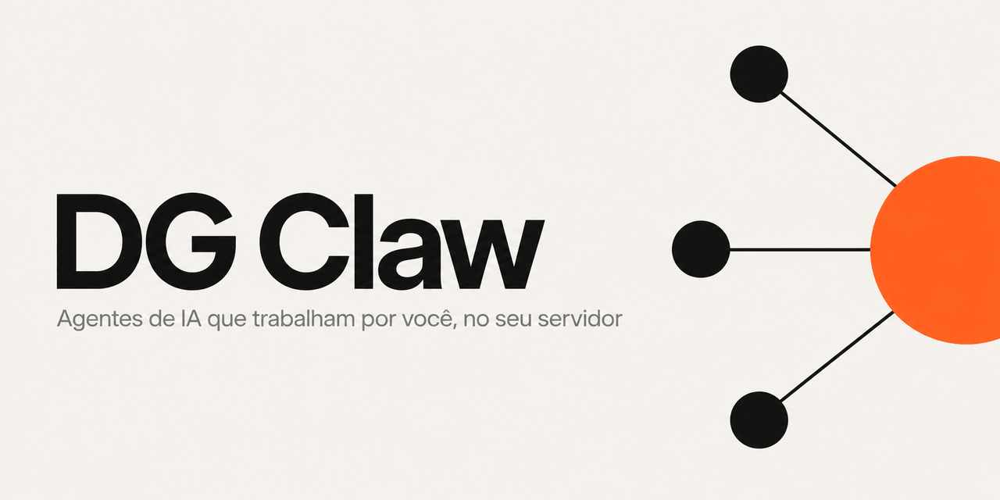
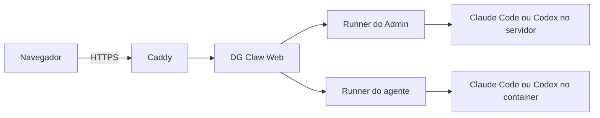

<p align="center">
  <picture>
    <source media="(prefers-color-scheme: dark)" srcset="docs/assets/banner-escuro.png">
    
  </picture>
</p>

<p align="center">
  <a href="https://github.com/DGatoM/DG-Claw/actions/workflows/ci.yml"></a>
  <a href="https://github.com/DGatoM/DG-Claw/releases"></a>
  <a href="LICENSE"></a>
  <a href="https://github.com/DGatoM/DG-Claw/actions/workflows/ci.yml"></a>
</p>

## O que é

O DG Claw instala num servidor Linux seu um painel web com login e chat, um agente de sistema (o
**Admin**) e a infraestrutura para rodar **agentes de trabalho**, cada um no próprio container, com a
própria casa de arquivos e o próprio cofre de chaves. Você cria os agentes conversando com o Admin, que
também cuida da máquina.

Os agentes usam o Claude Code ou o Codex, com a sua assinatura, então não há chave de API de modelo para
gerenciar. O projeto é para quem quer agentes de IA próprios e isolados entre si, sem montar a
infraestrutura na mão.

## Instalação

Precisa de uma VPS Ubuntu 24.04 ou 22.04, com acesso root, 2 GB de RAM, 15 GB livres, portas 80 e 443
disponíveis e o Claude Code ou o Codex já logado no servidor. O instalador mostra cada etapa em
português e pode ser executado de novo sem estragar nada. Ao terminar, ele entrega o endereço do painel e
um link de primeiro acesso (uso único, 30 minutos), onde você cadastra a senha no navegador.

```sh
git clone https://github.com/DGatoM/DG-Claw
cd DG-Claw
sudo ./install.sh --usuario admin --com-imagem
```

O guia completo, com requisitos, etapas e o que muda na máquina, está em [INSTALL.md](INSTALL.md).
`sudo ./install.sh --ensaio` só lista o que faria, sem mudar nada.

## Recursos

- **Admin**: agente de sistema que cria e administra os outros por conversa ([docs/ARQUITETURA.md](docs/ARQUITETURA.md#admin-e-agentes-de-trabalho)).
- **Container por agente**: casa de arquivos própria e sem acesso aos vizinhos nem ao servidor ([docs/SEGURANCA.md](docs/SEGURANCA.md#isolamento-entre-agentes)).
- **Cofre por agente**: chaves de serviço que valem só para quem as guardou ([docs/COFRE-POR-API.md](docs/COFRE-POR-API.md)).
- **Provedores**: Claude Code ou Codex, escolhidos na instalação ([docs/PROVEDORES.md](docs/PROVEDORES.md)).
- **Mesa de tarefas**: uma tela com o que cada agente faz, o que travou e o que espera por você ([docs/MESA-DE-TAREFAS.md](docs/MESA-DE-TAREFAS.md)).
- **Memória semântica**: o agente acha o que você disse pelo sentido, mesmo com outras palavras ([docs/MEMORIA-SEMANTICA.md](docs/MEMORIA-SEMANTICA.md)).
- **Canais**: o chat do painel vem pronto; o WhatsApp é um canal opcional ([docs/CANAL-WHATSAPP.md](docs/CANAL-WHATSAPP.md)).
- **Modo escondido**: mascara nomes, valores e chaves na tela para mostrar uma conversa sem expor dados ([docs/MODO-ESCONDIDO.md](docs/MODO-ESCONDIDO.md)).
- **Saúde e modo seguro**: o painel confere se cada agente está respondendo, não só de pé ([docs/SAUDE-E-MODO-SEGURO.md](docs/SAUDE-E-MODO-SEGURO.md)).
- **Emergência**: roteiro de socorro para quando um agente para ou fica estranho ([docs/EMERGENCIA.md](docs/EMERGENCIA.md)).

## Como funciona

O navegador chega ao Caddy (portas 80 e 443, HTTPS), que entrega o DG Claw Web em `127.0.0.1`. O Web
autentica você e encaminha cada mensagem ao **runner** correto, que mantém viva a sessão do Claude Code ou
do Codex. O runner do Admin roda no servidor; o de cada agente roda dentro do container do agente. As
respostas voltam pelo mesmo caminho para o chat. A descrição completa está em
[docs/ARQUITETURA.md](docs/ARQUITETURA.md).



## Segurança

- Só o Caddy escuta na internet, com HTTPS. Painel, runner e serviços internos ficam em `127.0.0.1`.
- Cada agente roda no próprio container e tem o próprio cofre. O `scripts/teste-isolamento.sh` confere o isolamento.
- O login do painel usa hash scrypt, sessão que vence, limite de tentativas e proteção contra CSRF.
- As chaves de API do painel são guardadas só como hash, e as chaves do cofre nunca aparecem inteiras na tela, na API nem no log.
- O agente começa com poderes limitados (o Gmail nasce só lendo) e você libera aos poucos.

Os limites também estão documentados: quem tem root na máquina enxerga tudo, e um agente comprometido
ainda alcança a internet. A lista está em [docs/SEGURANCA.md](docs/SEGURANCA.md#pendências-conhecidas).
Para relatar uma vulnerabilidade, veja o [SECURITY.md](SECURITY.md) ou abra um
[relato privado](https://github.com/DGatoM/DG-Claw/security/advisories/new).

## Atualização e backup

`sudo dgclaw atualizar` faz um backup datado em `/var/backups/dgclaw/`, baixa a versão nova, reinstala e
recria os agentes sem tocar nos dados deles. `--simular` mostra o que faria e `--voltar <backup>` desfaz.
O passo a passo está em [docs/ATUALIZAR.md](docs/ATUALIZAR.md), e as mudanças de cada versão em
[CHANGELOG.md](CHANGELOG.md).

## Contribuir

Contribuições são bem-vindas. As convenções e o fluxo de pull request estão em
[CONTRIBUTING.md](CONTRIBUTING.md). Antes de abrir o PR, rode a suíte:

```sh
bash tests/rodar.sh
```

## Licença

MIT. Veja o arquivo [LICENSE](LICENSE).
